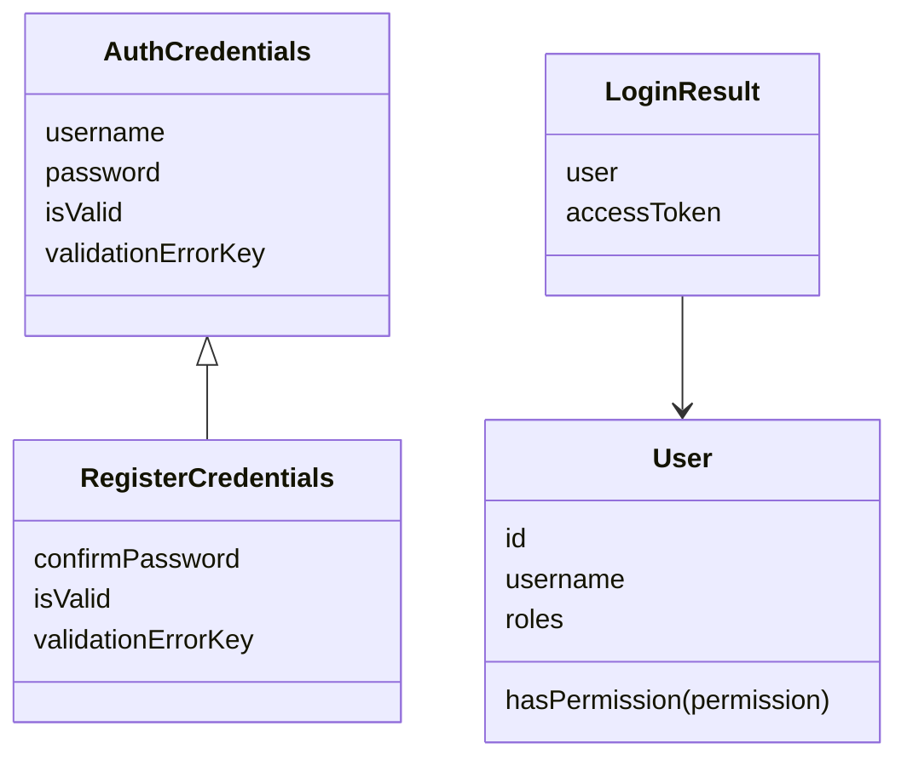
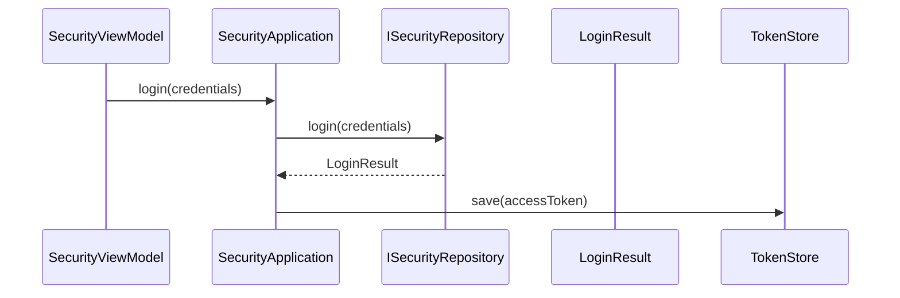

# 安全模块

## 目录

- [模块目录结构](#模块目录结构)
- [功能定义](#功能定义)
- [核心业务层](#核心业务层)
  - [SecurityViewModel](#securityviewmodel)
- [核心模型](#核心模型)
- [核心业务](#核心业务)
  - [登录](#登录)

## 模块目录结构

```text
src/features/security/
├── application/
│   └── security_application.ts
├── domain/
│   ├── entities/
│   │   ├── auth_credentials.ts
│   │   ├── register_credentials.ts
│   │   ├── login_result.ts
│   │   └── user.ts
│   ├── enum/
│   │   └── auth_enum.ts
│   └── repositories/
│       └── i_security_repository.ts
├── i18n/
├── infra/
│   └── persistence/
│       └── security_repository.ts
├── presentation/
│   ├── profile/
│   └── security/
└── security.ts
```

`security.ts` 导入文案和 `SecurityRepository`。`profile` 页面没有用例。

## 功能定义

安全模块提供身份用例。

- `login(credentials)`：校验身份，得到 `LoginResult`。用例再把其中的访问凭证写入会话。
- `register(credentials)`：注册一个用户。
- `logout()`：清除会话中的凭证。

这些方法在 `SecurityApplication`。端口方法名不带 `remote`。

## 核心业务层

### SecurityViewModel

登录与注册页的状态。文件：`src/features/security/presentation/security/security_view_model.ts`。继承 `PageViewModel`。

状态：`activeTab`、`isLoading`、`errorMessage`、`loginForm`、`registerForm`。

| 方法 | 说明 |
|---|---|
| `switchTab(tab: AuthEnum): void` | 在 `LOGIN` 与 `REGISTER` 之间切换，并清空 `errorMessage` |
| `submit(): Promise<boolean>` | 表单已经由领域对象判定有效后，登录调用 `login`，注册调用 `register` |
| `dispose(): void` | 清空 `errorMessage` |

`submit` 在 `isValid` 不为真时，用 `validationErrorKey` 取出文案并返回 `false`。登录成功返回 `true`。注册成功后切回 `LOGIN` 并返回 `false`。

## 核心模型

| 类型 | 文件 | 定义 |
|---|---|---|
| `AuthCredentials` | `src/features/security/domain/entities/auth_credentials.ts` | 登录凭证。用户名不少于 3 个字符，密码不少于 6 个字符 |
| `RegisterCredentials` | `src/features/security/domain/entities/register_credentials.ts` | 注册凭证。在登录凭证上增加一次确认密码，两次密码必须相同 |
| `User` | `src/features/security/domain/entities/user.ts` | 用户。持有 `id`、`username`、`roles` |
| `LoginResult` | `src/features/security/domain/entities/login_result.ts` | 一次成功的登录。持有 `User` 和 `accessToken` |
| `ISecurityRepository` | `src/features/security/domain/repositories/i_security_repository.ts` | `login` 返回 `LoginResult`，`register` 接收 `RegisterCredentials` |



`User.hasPermission` 在角色包含 `admin` 或指定权限时返回真。登录失败不产生 `LoginResult`。

## 核心业务

### 登录



`SecurityViewModel.submit` 在 `activeTab` 为 `LOGIN` 时调用 `login`。仓储返回的是 `User` 和 `accessToken`，不是未标明类型的用户字段。用例只把 `accessToken` 交给 `TokenStore.save`。`AUTH_CHANGED` 是会话发出的界面通知，不是领域事件。通知怎样到达页面，见 [会话](../../基础应用/会话(session).md)。
