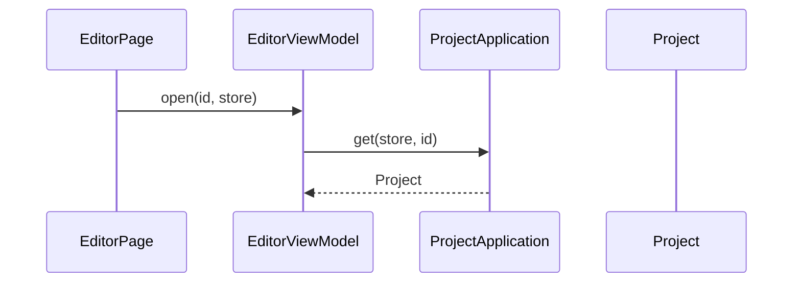

# 打开项目

## 目录

- [业务定义](#业务定义)
- [时序](#时序)

## 业务定义

编辑页根据路由中的 `projectId` 和 `store` 载入 `Project`，并清空尚未落笔的草稿。

本事件使用 `EditorViewModel.open`。参数 `store` 必须是枚举 `ProjectStore` 的取值。

## 时序

`id` 或 `store` 为空时，`errorMessage` 为缺少项目。`store` 不在 `ProjectStore` 的取值里时，`errorMessage` 为项目存储无效。这两种情况都不再请求。读到的聚合写入 `project`，并记下 `store`，同时清空 `draft`。没有这个项目时，`errorMessage` 为找不到项目。
