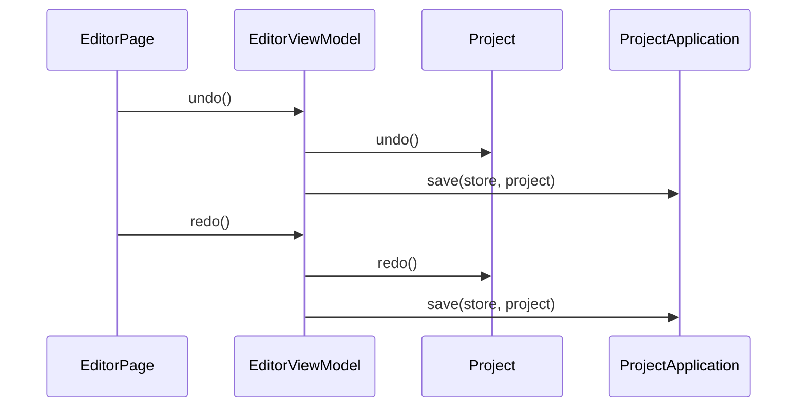

# 撤销与重做

## 目录

- [业务定义](#业务定义)
- [时序](#时序)

## 业务定义

编辑器请求 `Project` 后退或前进一份文档，并把聚合保存。快照由 `Project` 持有。

本事件使用 `EditorViewModel` 的 `undo`、`redo`。

## 时序

`Project.undo` 没有更早的快照时返回失败，页面不调用 `save`。成功时聚合把当前文档换回上一份快照。`Project.redo` 没有更新的快照时同样不保存。成功时聚合恢复下一份快照。两次成功之后都按 `store` 调用 `ProjectApplication.save`。
