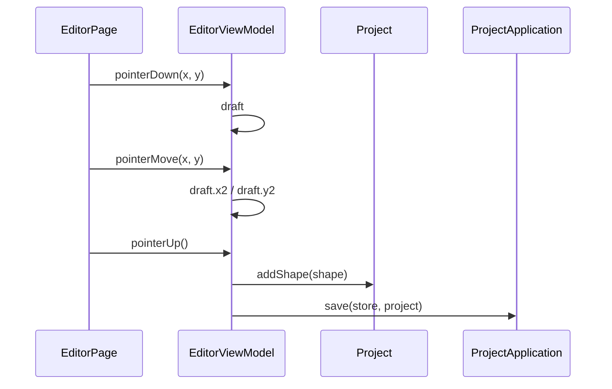

# 绘制

## 目录

- [业务定义](#业务定义)
- [时序](#时序)

## 业务定义

用户在画布上按下、移动、抬起指针。编辑器按当前工具形成草稿，再交给 `Project.addShape`。聚合接受这次落笔后，用例保存整个 `Project`。

本事件使用 `EditorViewModel` 的 `pointerDown`、`pointerMove`、`pointerUp`。是否落笔由 `Project.addShape` 决定。

## 时序

`pointerDown` 要求已经打开项目，并用当前 `EditorTool` 创建 `DraftShape`。`pointerMove` 只在存在草稿时调用 `DraftShape.move`。`pointerUp` 先清掉草稿，再按工具生成 `LineShape` 或 `RectShape` 并调用 `addShape`。位移小于 2 时 `addShape` 拒绝，不保存。接受时，聚合自己记下文档快照并写入图形，然后 `save` 按页面上的 `store` 写回仓储。
