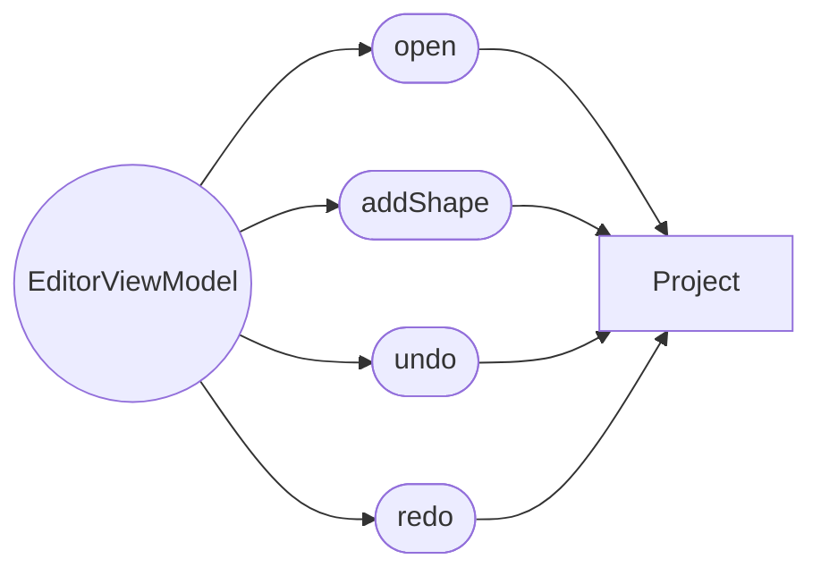

# 编辑器模块

## 目录

- [模块目录结构](#模块目录结构)
- [功能定义](#功能定义)
- [核心业务层](#核心业务层)
  - [EditorViewModel](#editorviewmodel)
- [核心模型](#核心模型)
- [业务文档](#业务文档)

## 模块目录结构

```text
src/features/editor/
├── domain/
│   ├── entities/
│   │   └── draft_shape.ts
│   └── enum/
│       └── editor_tool.ts
└── presentation/
    └── editor/
        ├── editor.tsx
        ├── editor.scss
        └── editor_view_model.ts
```

编辑器不定义自己的聚合和用例。文档规则在项目模块的 `Project` 上。当前工具和未落笔的草稿是编辑器自己的领域对象。

## 功能定义

编辑器把页面动作提交给已经载入的 `Project`，再交给项目用例保存。

- 按 `projectId` 和 `store` 载入聚合。
- 按当前工具收集指针草稿，落笔时调用 `Project.addShape`。
- 调用 `Project.undo` 或 `Project.redo`，再保存。

## 核心业务层

### EditorViewModel

编辑页的状态和操作。文件：`src/features/editor/presentation/editor/editor_view_model.ts`。继承 `PageViewModel`。

状态：`project`、`store`、`tool`、`draft`、`errorMessage`。撤销栈不在这里。

| 方法 | 说明 |
|---|---|
| `open(id: string, store: string \| null): Promise<void>` | 按 `store` 读取 `Project`，并清空 `draft` |
| `setTool(tool: EditorTool): void` | 切换 `EditorTool.LINE` 或 `EditorTool.RECT` |
| `pointerDown(x: number, y: number): void` | 在已有项目时记下草稿起点 |
| `pointerMove(x: number, y: number): void` | 更新草稿终点 |
| `pointerUp(): void` | 用草稿调用 `Project.addShape`，接受后保存 |
| `undo(): void` | 调用 `Project.undo`，成功后保存 |
| `redo(): void` | 调用 `Project.redo`，成功后保存 |

`store` 只记录这次页面从本地还是远程打开，供 `ProjectApplication.get` 和 `save` 选择仓储。

## 核心模型

编辑器定义当前工具和未落笔的草稿。已提交的图形和撤销规则仍在项目模块的 `Project` 上，见 [项目模块](../项目模块/项目模块(project).md)。

| 类型 | 文件 | 定义 |
|---|---|---|
| `EditorTool` | `src/features/editor/domain/enum/editor_tool.ts` | 当前工具。`LINE` 与 `RECT` |
| `DraftShape` | `src/features/editor/domain/entities/draft_shape.ts` | 一笔尚未提交的草稿。持有工具和起点、终点 |



`open` 载入 `Project`。`addShape`、`undo`、`redo` 都调用这个聚合根，不调用 `Document`。

## 业务文档

- [打开项目](./打开项目.md)
- [绘制](./绘制.md)
- [撤销与重做](./撤销与重做.md)
