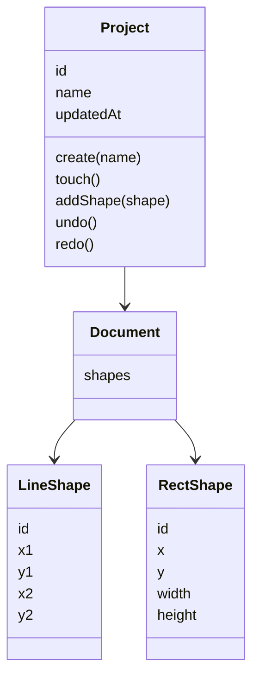
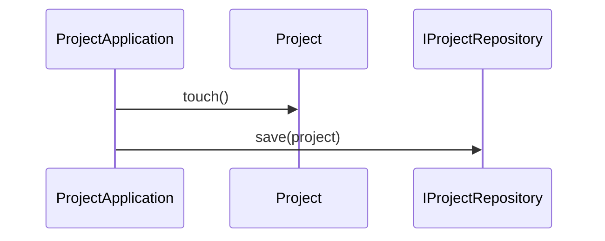

# 项目模块

## 目录

- [模块目录结构](#模块目录结构)
- [功能定义](#功能定义)
- [核心业务层](#核心业务层)
  - [ProjectListViewModel](#projectlistviewmodel)
- [核心模型](#核心模型)
- [核心业务](#核心业务)
  - [保存项目](#保存项目)

## 模块目录结构

```text
src/features/project/
├── application/
│   └── project_application.ts
├── domain/
│   ├── entities/
│   │   ├── document.ts
│   │   └── project.ts
│   ├── enum/
│   │   └── project_store.ts
│   └── repositories/
│       └── i_project_repository.ts
├── infra/
│   └── persistence/
│       ├── local_project_repository.ts
│       └── remote_project_repository.ts
├── presentation/
│   ├── local_list/
│   ├── project_list/
│   ├── project_row/
│   └── remote_list/
└── project.ts
```

`project.ts` 导入 `LocalProjectRepository` 和 `RemoteProjectRepository`。两者都实现 `IProjectRepository`，由应用层按 `store` 选择。`store` 是领域枚举 `ProjectStore`，取值 `local` 与 `remote`，不是 `Project` 的字段。

## 功能定义

项目模块维护 `Project` 聚合，并按 `store` 选择仓储。

- `list(store)`：列出该存储位置的项目。
- `get(store, id)`：读取一个项目。
- `save(store, project)`：调用 `Project.touch` 后保存整个聚合。
- `create(store, name)`：通过 `Project.create` 新建项目并保存。`local` 写入本地仓储，`remote` 写入远程仓储。

这些方法在 `ProjectApplication`。页面和编辑器不直接选择仓储实现。

## 核心业务层

### ProjectListViewModel

本地列表和远程列表页的状态。文件：`src/features/project/presentation/project_list/project_list_view_model.ts`。继承 `PageViewModel`。

状态：`projects`、`errorMessage`。

| 方法                                       | 说明                                            |
| ------------------------------------------ | ----------------------------------------------- |
| `load(store: ProjectStore): Promise<void>` | 调用 `ProjectApplication.list`，写入 `projects` |

`ProjectStore` 定义在 `domain/enum/project_store.ts`。`ProjectListPage` 在进入页面时调用 `load`。本地页传入 `ProjectStore.LOCAL`，远程页传入 `ProjectStore.REMOTE`。

## 核心模型

`Project` 是聚合根。外部只通过它修改文档和图形。

| 类型                 | 文件                                                               | 定义                                                           |
| -------------------- | ------------------------------------------------------------------ | -------------------------------------------------------------- |
| `Project`            | `src/features/project/domain/entities/project.ts`                  | 聚合根。持有 `id`、`name`、`updatedAt`、`document`，以及撤销栈 |
| `ProjectStore`       | `src/features/project/domain/enum/project_store.ts`                | 存储位置。`LOCAL` 与 `REMOTE`                                  |
| `Document`           | `src/features/project/domain/entities/document.ts`                 | 聚合内部的图形文档，持有 `shapes`                              |
| `LineShape`          | 同上                                                               | 一条线段                                                       |
| `RectShape`          | 同上                                                               | 一个矩形                                                       |
| `IProjectRepository` | `src/features/project/domain/repositories/i_project_repository.ts` | `list`、`get`、`save`。不区分存储位置                          |



`Project.create` 生成 `id`、名称和空文档。`touch` 把 `updatedAt` 写成当前时间。

`addShape` 是唯一写入图形的方法。线段或矩形的位移小于 2 时拒绝，文档保持不变。通过时，先记下当前文档快照，再把图形放入 `Document`。

`undo` 在没有更早的快照时不做。否则把当前文档换回上一份快照。`redo` 按相反方向恢复。快照存在聚合内部，不放在页面 ViewModel 里。

## 核心业务

### 保存项目



`ProjectApplication` 按 `store` 把 `IProjectRepository` 指到 `LocalProjectRepository` 或 `RemoteProjectRepository`，再调用 `save`。`list`、`get`、`create` 使用同一次选择。领域端口上看不到 `local` 或 `remote`。
