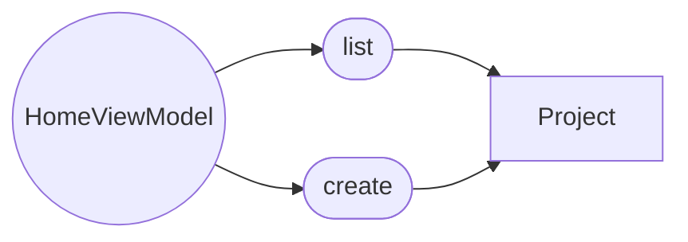
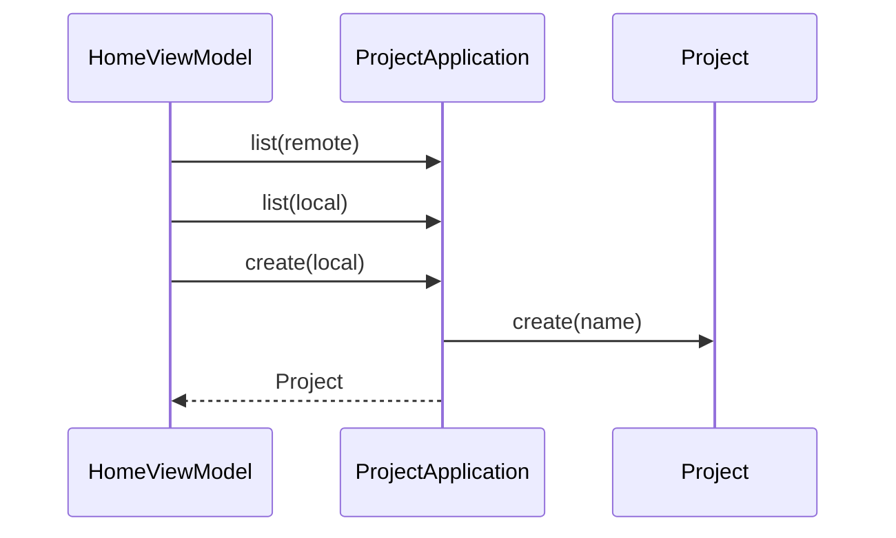

# 首页

## 目录

- [模块目录结构](#模块目录结构)
- [功能定义](#功能定义)
- [核心业务层](#核心业务层)
  - [HomeViewModel](#homeviewmodel)
- [核心模型](#核心模型)
- [核心业务](#核心业务)
  - [列出并新建](#列出并新建)

## 模块目录结构

```text
src/features/home/
└── presentation/
    └── home/
        ├── home.tsx
        ├── home.scss
        └── home_view_model.ts
```

首页没有 `application`、`domain`、`infra`。

## 功能定义

首页不持有独立用例。它调用项目模块的 `list` 和 `create`。

- 进入页面时按 `local` 与 `remote` 各列出一份项目。
- 新建时调用 `ProjectApplication.create`。聚合由 `Project.create` 生成，再按 `store` 保存。

已登录状态来自安全模块一侧的 `authenticated`。未登录时，`projectId` 不交给编辑器。

## 核心业务层

### HomeViewModel

首页的项目列表状态。文件：`src/features/home/presentation/home/home_view_model.ts`。继承 `PageViewModel`。

状态：`cloudProjects`、`localProjects`、`errorMessage`。

| 方法 | 说明 |
|---|---|
| `ready(): Promise<void>` | 进入页面时调用 `reload` |
| `reload(): Promise<void>` | 调用 `ProjectApplication.list(ProjectStore.REMOTE)` 和 `list(ProjectStore.LOCAL)` |
| `createLocal(): Promise<Project>` | 调用 `ProjectApplication.create(ProjectStore.LOCAL)` |

`local` 和 `remote` 是传给用例的 `store`，用来选择仓储。它们不是 `Project` 的属性。

## 核心模型

首页不定义实体。它使用项目模块的聚合根 `Project`。



`list` 的结果写入 `cloudProjects` 或 `localProjects`。`create` 返回新建的 `Project`。

## 核心业务

### 列出并新建



`ready` 触发两次 `list`。其中一次失败时，对应列表为空，错误写入 `errorMessage`。`create` 返回的 `Project.id` 与本次使用的 `store` 一起交给编辑器。
