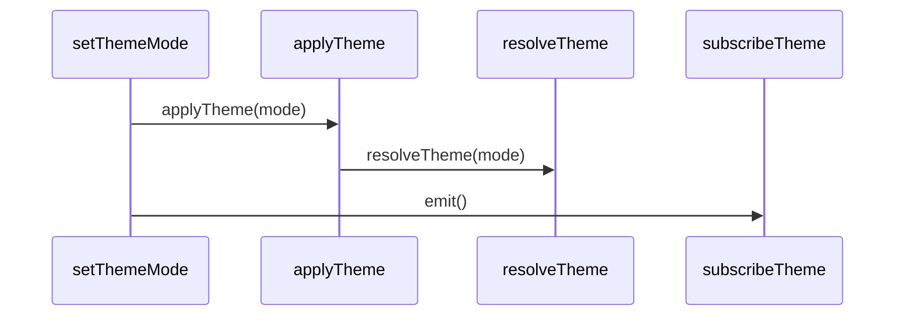

# 主题

## 目录

- [功能定义](#功能定义)
- [使用示例](#使用示例)
- [时序](#时序)
  - [切换主题](#切换主题)

## 功能定义

主题保存 `light`、`dark` 或 `system`，解析成实际的 `light` 或 `dark`，并交给界面库。

| 入口 | 文件 | 定义 |
|---|---|---|
| `getThemeMode()` | `src/app/theme/theme.ts` | 读取保存的 `ThemeMode`，缺省为 `system` |
| `resolveTheme(mode)` | 同上 | 把 `ThemeMode` 解析为 `ResolvedTheme` |
| `setThemeMode(mode)` | 同上 | 保存模式、涂色，并通知订阅者 |
| `subscribeTheme(listener)` | 同上 | 订阅主题变化 |
| `useThemeMode()` | `src/app/theme/use_theme.ts` | 读取当前 `ThemeMode` |
| `useResolvedTheme()` | 同上 | 读取当前 `ResolvedTheme` |
| `antdTheme(resolved)` | `src/app/theme/antd_theme.ts` | 按解析结果选择界面库算法 |

## 使用示例

应用外壳把解析结果交给界面库。文件：`src/app/routes/app_shell.tsx`。

```ts
const resolved = useResolvedTheme();
<ConfigProvider theme={antdTheme(resolved)} />
```

## 时序

### 切换主题



`setThemeMode` 写入本地后调用 `applyTheme`。`resolveTheme` 在模式为 `system` 时读取系统配色，否则直接采用 `light` 或 `dark`。涂色写到 `documentElement.dataset.theme`，然后通知 `subscribeTheme` 的监听者。`useResolvedTheme` 通过这个订阅更新界面。首次涂色在根组件挂载之后执行，水合完成前不改 `<html>` 上的属性。
