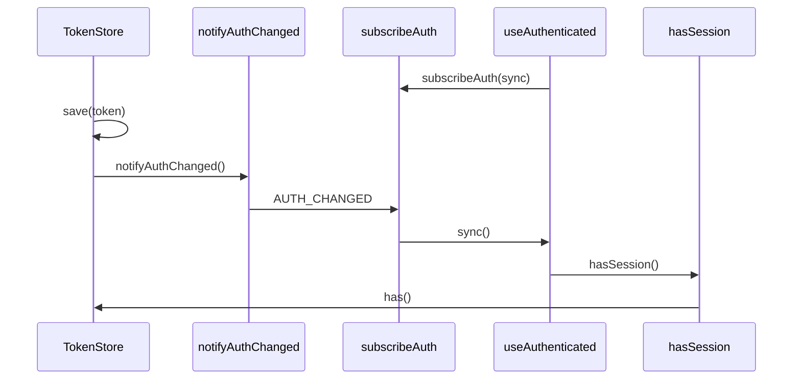

# 会话

## 目录

- [功能定义](#功能定义)
- [使用示例](#使用示例)
- [时序](#时序)
  - [凭证变化](#凭证变化)

## 功能定义

会话负责登录凭证的保存、读取和清除，并在凭证变化后通知界面。`AUTH_CHANGED` 只表示凭证变了，不是领域事件。登录是否成功由安全模块的 `LoginResult` 决定。

| 入口                      | 文件                                   | 定义                                       |
| ------------------------- | -------------------------------------- | ------------------------------------------ |
| `TokenStore.save(token)`  | `src/app/session/token_store.ts`       | 写入凭证并调用 `notifyAuthChanged`         |
| `TokenStore.get()`        | 同上                                   | 读出凭证；没有则返回 `null`                |
| `TokenStore.remove()`     | 同上                                   | 清除凭证并调用 `notifyAuthChanged`         |
| `TokenStore.has()`        | 同上                                   | 当前是否持有凭证                           |
| `hasSession()`            | `src/app/session/auth_session.ts`      | 从根容器取出 `TokenStore` 并调用 `has()`   |
| `useAuthenticated()`      | `src/app/session/use_authenticated.ts` | 订阅 `AUTH_CHANGED`，得到当前是否已登录    |
| `notifyAuthChanged()`     | `src/app/session/auth_event.ts`        | 发出 `AUTH_CHANGED`                        |
| `subscribeAuth(listener)` | 同上                                   | 登记 `AUTH_CHANGED` 的监听，并返回取消函数 |

## 使用示例

安全模块在登录成功后写入凭证，登出时清除。文件：`src/features/security/application/security_application.ts`。

```ts
async login(credentials: AuthCredentials): Promise<void> {
  const result = await this.repository.login(credentials);
  this.tokenStore.save(result.accessToken);
}

async logout(): Promise<void> {
  this.tokenStore.remove();
}
```

路由用 `hasSession()` 判断能否进入。文件：`src/app/routes/layouts/auth.layout.tsx`。

```ts
const policy = decideRoutePolicy('require-auth', hasSession(), url.pathname, url.search);
```

## 时序

### 凭证变化



`TokenStore.save` 和 `TokenStore.remove` 改完本地凭证后调用 `notifyAuthChanged`。`notifyAuthChanged` 发出 `AUTH_CHANGED`。`useAuthenticated` 事先通过 `subscribeAuth` 登记 `sync`，收到事件后再次调用 `hasSession`。`hasSession` 只调用 `TokenStore.has`。
