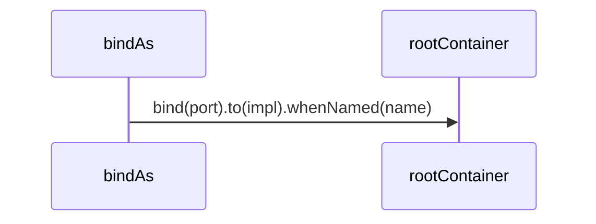

# 依赖注入

## 目录

- [功能定义](#功能定义)
- [使用示例](#使用示例)
- [时序](#时序)
  - [绑定端口](#绑定端口)

## 功能定义

依赖注入提供全库共用的根容器，并把功能模块的端口绑定到具体实现。容器默认单例，且对带 `@injectable` 的类自动绑定。

| 入口 | 文件 | 定义 |
|---|---|---|
| `rootContainer` | `src/app/di/root_container.ts` | 根容器。`autobind` 打开，`defaultScope` 为 `Singleton` |
| `bindAs(port, name?)` | `src/app/di/bind_as.ts` | 把抽象端口绑定到实现类。同一端口有多个实现时传入 `name` |

## 使用示例

安全模块把 `ISecurityRepository` 绑到 `SecurityRepository`。文件：`src/features/security/infra/persistence/security_repository.ts`。

```ts
@bindAs(ISecurityRepository)
@injectable('Singleton')
export class SecurityRepository implements ISecurityRepository {}
```

`@bindAs` 写在 `@injectable` 上面。类装饰器从靠近类的那一个开始执行，`@injectable` 先写入构造参数类型，`bind(port).to(impl)` 才能读到。

项目模块把同一个 `IProjectRepository` 绑两次，用名称区分：

```ts
@bindAs(IProjectRepository, ProjectStore.LOCAL)
@injectable('Singleton')
export class LocalProjectRepository implements IProjectRepository {}
```

`RemoteProjectRepository` 使用 `ProjectStore.REMOTE`。用例按名称注入抽象端口：

```ts
constructor(
  @inject(IProjectRepository) @named(ProjectStore.LOCAL) private localRepository: IProjectRepository,
  @inject(IProjectRepository) @named(ProjectStore.REMOTE) private remoteRepository: IProjectRepository,
) {}
```

模块入口负责导入这些实现，绑定才会执行。文件：`src/features/security/security.ts`。

```ts
import './infra/persistence/security_repository';
```

## 时序

### 绑定端口



`bindAs` 返回的装饰器在类定义时把端口绑到实现。带名称时用 `whenNamed` 区分同一端口的多个实现。同一个实现再次执行时，先卸掉上一次的绑定再绑。用例构造函数用 `@inject` 指定端口，用 `@named` 指定实现，容器创建用例时传入对应的仓储。
