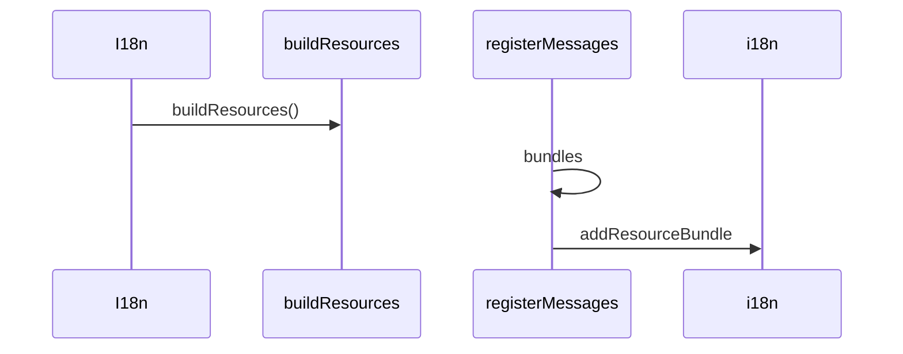

# 国际化

## 目录

- [功能定义](#功能定义)
- [使用示例](#使用示例)
- [时序](#时序)
  - [注册文案](#注册文案)

## 功能定义

国际化保存各模块的文案，并按当前语言取出文本。默认回退语言是 `zh`。

| 入口 | 文件 | 定义 |
|---|---|---|
| `registerMessages(feature, locales)` | `src/app/i18n/catalog.ts` | 把一个功能模块的 `zh`、`en` 文案写入目录 |
| `buildResources()` | 同上 | 把已登记的文案交给 i18next |
| `I18n.translate(key)` | `src/app/i18n/i18n.ts` | 按键取出当前语言的文本 |
| `I18n.changeLanguage(lng)` | 同上 | 切换 `zh` 或 `en` |
| `I18n.currentLanguage` | 同上 | 当前语言 |

功能模块自己的键缺失时，`parseMissingKeyHandler` 会改查 `common` 下的同名键。

## 使用示例

安全模块在加载时登记文案。文件：`src/features/security/i18n/index.ts`。

```ts
registerMessages('security', { zh: zhCN, en: enUS });
```

页面 ViewModel 取文本。文件：`src/features/security/presentation/security/security_view_model.ts`。

```ts
this.errorMessage = this.i18n.translate(currentForm.validationErrorKey);
```

## 时序

### 注册文案



`I18n` 构造时用 `buildResources` 初始化。此后 `registerMessages` 写入 `bundles`；i18next 已经初始化时，再调用 `addResourceBundle`。尚未初始化时只写入 `bundles`，等 `I18n` 构造时一并载入。
