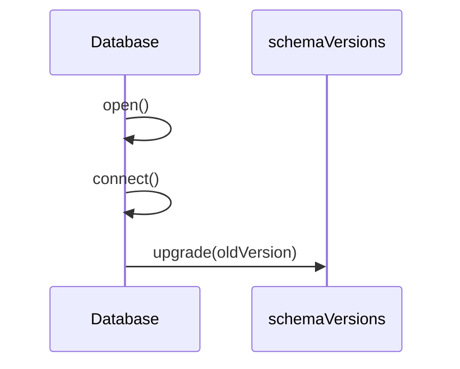

# 数据库

## 目录

- [功能定义](#功能定义)
- [使用示例](#使用示例)
- [时序](#时序)
  - [打开并升级](#打开并升级)

## 功能定义

数据库打开名为 `local_db` 的 IndexedDB，并按 `schemaVersions` 从旧版本逐级升级。

| 入口               | 文件                         | 定义                                                |
| ------------------ | ---------------------------- | --------------------------------------------------- |
| `Database.open()`  | `src/app/db/database.ts`     | 打开数据库。同一时刻复用同一次打开                  |
| `Database.reset()` | 同上                         | 关闭进行中的打开，并删除 `local_db`                 |
| `schemaVersions`   | `src/app/db/schema/index.ts` | 按版本排列的升级函数。`DB_VERSION` 等于它的长度     |
| `upgradeV1`        | `src/app/db/schema/v1.ts`    | 第一版。创建 `projects` 对象仓库，`keyPath` 为 `id` |

## 使用示例

本地项目仓储在读写前打开数据库。文件：`src/features/project/infra/persistence/local_project_repository.ts`。

```ts
const db = await this.database.open();
```

对象仓库不存在时，仓储关闭连接并调用 `Database.reset()`，再打开一次。

## 时序

### 打开并升级



`open` 若已有进行中的连接，直接返回该连接。`onupgradeneeded` 时，`upgrade` 从 `oldVersion` 走到 `newVersion`，依次执行 `schemaVersions` 里对应的函数。版本变化导致连接关闭时，下一次 `open` 重新连接。
