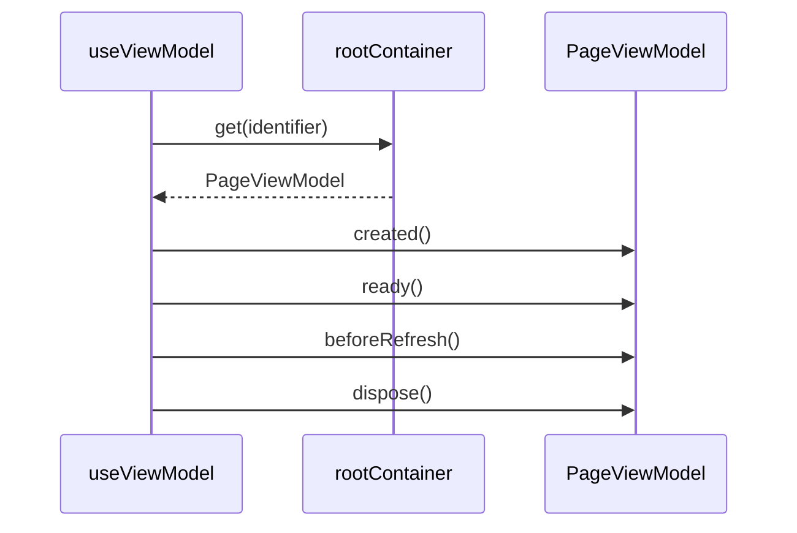

# 生命周期

## 目录

- [功能定义](#功能定义)
- [使用示例](#使用示例)
- [时序](#时序)
  - [页面 ViewModel](#页面-viewmodel)

## 功能定义

生命周期负责创建页面 ViewModel，并在进入、刷新、离开时回调。

| 入口 | 文件 | 定义 |
|---|---|---|
| `PageViewModel` | `src/app/lifecycle/page_view_model.ts` | 页面 ViewModel 的基类。回调为 `created`、`ready`、`beforeRefresh`、`dispose` |
| `useViewModel(identifier)` | `src/app/lifecycle/use_view_model.ts` | 从根容器取出 ViewModel，并接上上述回调 |

## 使用示例

编辑器页面取出 `EditorViewModel`。文件：`src/features/editor/presentation/editor/editor.tsx`。

```ts
const vm = useViewModel(EditorViewModel);
```

ViewModel 继承 `PageViewModel`，需要在容器里可解析。文件：`src/features/editor/presentation/editor/editor_view_model.ts`。

```ts
@injectable('Transient')
export class EditorViewModel extends PageViewModel {}
```

## 时序

### 页面 ViewModel



`created` 在首次取出实例时调用。`ready` 在效果提交后调用。窗口触发 `pagehide` 时调用 `beforeRefresh`。离开页面时去掉监听并调用 `dispose`。
