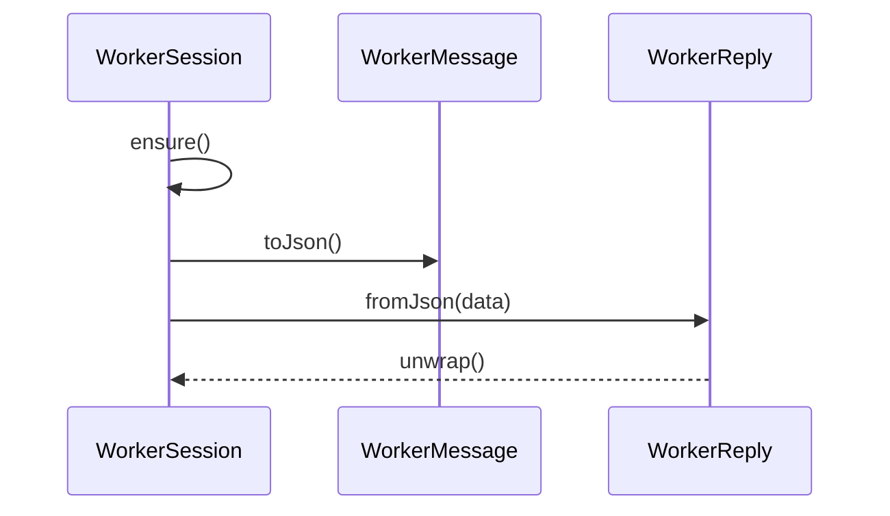

# 线程脚本

## 目录

- [功能定义](#功能定义)
- [使用示例](#使用示例)
- [时序](#时序)
  - [请求与回复](#请求与回复)

## 功能定义

线程脚本管理一个 Worker 的创建、请求和崩溃。当前没有功能模块调用它。

| 入口                             | 文件                                        | 定义                                                             |
| -------------------------------- | ------------------------------------------- | ---------------------------------------------------------------- |
| `WorkerSession.request(message)` | `src/app/worker/worker_session.ts`          | 保证 Worker 存在，发送 `WorkerMessage`，并等待对应 `WorkerReply` |
| `WorkerSession.dispose()`        | 同上                                        | 拒绝尚未完成的请求，并终止 Worker                                |
| `WorkerRuntime.listen(handlers)` | `src/app/worker/worker_runtime.ts`          | 在 Worker 线程按 `type` 分发，并用 `WorkerReply` 回复            |
| `WorkerMessage`                  | `src/app/worker/entities/worker_message.ts` | 请求体。含 `id`、`type`、`payload`                               |
| `WorkerReply`                    | `src/app/worker/entities/worker_reply.ts`   | 回复体。按 `id` 交回等待中的请求                                 |
| `WorkerError`                    | `src/app/worker/entities/worker_error.ts`   | Worker 失败时的错误                                              |

连续崩溃超过一次后，`WorkerSession` 停止再创建，后续 `request` 直接拒绝。

## 使用示例

调用方传入创建函数，再发送一条消息。

```ts
const worker = new WorkerSession(() => new Worker('worker.js'));
const message = new WorkerMessage('type', payload);
const result = await worker.request(message);
```

## 时序

### 请求与回复



`ensure` 没有实例时调用构造函数传入的工厂。`request` 按 `WorkerMessage.id` 登记等待。Worker 线程里的 `WorkerRuntime.listen` 按 `type` 调用处理函数，并用 `WorkerReply` 回复。`onmessage` 用 `WorkerReply.fromJson` 找到同一 `id`，再 `unwrap` 完成该请求。`onerror` 或 `onmessageerror` 时终止当前 Worker，并拒绝尚未完成的请求。
