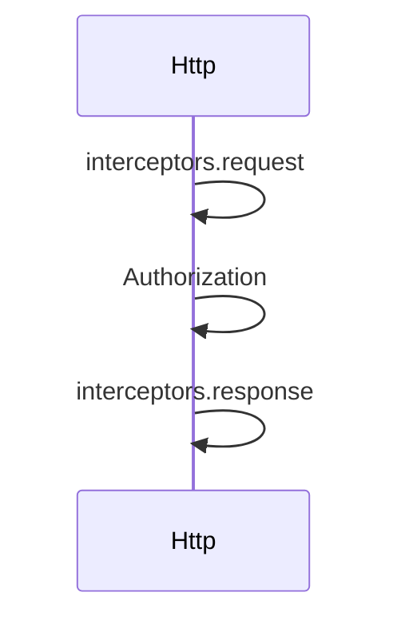

# 网络

## 目录

- [功能定义](#功能定义)
- [使用示例](#使用示例)
- [时序](#时序)
  - [本站请求](#本站请求)

## 功能定义

网络提供两个 HTTP 客户端。`Http` 访问本站接口，自动附带凭证，并在 401 时清除凭证。`ExternalHttp` 访问第三方接口，响应体原样返回。

| 入口 | 文件 | 定义 |
|---|---|---|
| `Http.instance` | `src/app/network/http.ts` | 本站 Axios 实例。请求拦截器读取凭证，响应拦截器按 `code` 解包 |
| `ExternalHttp.instance` | `src/app/network/external_http.ts` | 第三方 Axios 实例。成功时返回 `response.data` |

`Http` 在响应 `code` 不是 200 时拒绝。状态码为 401 时调用 `TokenStore.remove`。凭证如何保存见 [会话](./会话(session).md)。

## 使用示例

安全仓储通过 `Http.instance` 提交登录。文件：`src/features/security/infra/persistence/security_repository.ts`。

```ts
return await this.http.instance.post('/auth/login', plainDto);
```

## 时序

### 本站请求



请求拦截器读取凭证，有凭证时写入 `Authorization`。响应拦截器在 `code` 为 200 时返回 `data`，否则拒绝。状态码为 401 时清除凭证并离开当前页。`ExternalHttp` 不写入 `Authorization`，也不读取 `code`。
