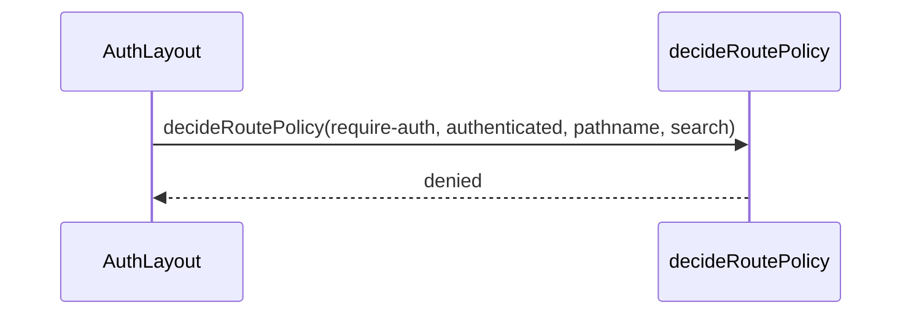

# 路由

## 目录

- [功能定义](#功能定义)
- [使用示例](#使用示例)
- [时序](#时序)
  - [访问策略](#访问策略)

## 功能定义

路由把 URL 指到功能模块页面，并用布局策略决定未登录或已登录时能否进入。

| 入口                | 文件                                            | 定义                                                              |
| ------------------- | ----------------------------------------------- | ----------------------------------------------------------------- |
| 路由表              | `src/app/routes.ts`                             | 声明页面路径和所属布局                                            |
| `decideRoutePolicy` | `src/app/routes/layouts/decide_route_policy.ts` | 根据 `require-auth` 或 `require-guest` 返回 `allowed` 或 `denied` |
| `AuthLayout`        | `src/app/routes/layouts/auth.layout.tsx`        | 已登录区域。未登录时拒绝                                          |
| `GuestLayout`       | `src/app/routes/layouts/guest.layout.tsx`       | 访客区域。已登录时拒绝                                            |

路由表：

| 路径                 | 布局        | 页面                |
| -------------------- | ----------- | ------------------- |
| `/`                  | `app_shell` | `home`              |
| `/security`          | `guest`     | `security`          |
| `/profile`           | `auth`      | `security` 的资料页 |
| `/projects/remote`   | `auth`      | `project`           |
| `/projects/local`    | `auth`      | `project`           |
| `/editor/:projectId` | `auth`      | `editor`            |

## 使用示例

已登录布局把 `hasSession()` 交给策略。文件：`src/app/routes/layouts/auth.layout.tsx`。

```ts
const policy = decideRoutePolicy('require-auth', hasSession(), url.pathname, url.search);
if (policy.status === 'denied') throw redirect(policy.redirect.to);
```

## 时序

### 访问策略



`require-auth` 且未登录时，结果是 `denied`，`redirect.to` 指向 `/security`，并带上当前路径。`require-guest` 且已登录时，`redirect.to` 为 `/`。其余情况为 `allowed`。`GuestLayout` 使用 `require-guest`，步骤相同。
