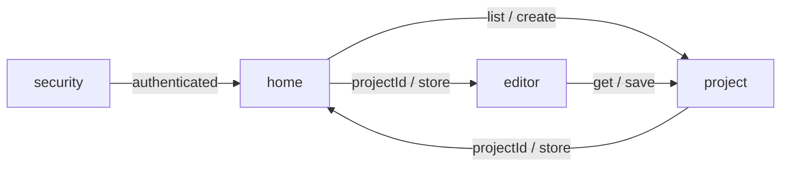

# 项目架构

## 目录

- [项目目录结构](#项目目录结构)
- [模块定义](#模块定义)
  - [基础应用](#基础应用)
  - [功能模块](#功能模块)
- [模块间数据流](#模块间数据流)
  - [项目业务](#项目业务)

## 项目目录结构

本仓库是脚手架。`src/app` 是每个项目保留的基础应用。`src/features` 下的四个目录是示例业务，用来示范功能模块如何接入；新项目可以替换它们。

```text
src/
├── app/
│   ├── db/
│   ├── di/
│   ├── i18n/
│   ├── lifecycle/
│   ├── network/
│   ├── routes/
│   ├── session/
│   ├── theme/
│   ├── worker/
│   ├── entry.client.tsx
│   ├── root.tsx
│   └── routes.ts
├── assets/
└── features/
    ├── editor/
    ├── home/
    ├── project/
    └── security/
```

## 模块定义

`src/app` 下每个目录是一个基础应用，供功能模块和路由使用。`src/features` 下每个目录是一个功能模块，承载一块业务。功能模块的定义写它的 application 用例。

### 基础应用

| 模块                                            | 目录                | 定义                                           |
| ----------------------------------------------- | ------------------- | ---------------------------------------------- |
| [数据库](<./基础应用/数据库(Database).md>)      | `src/app/db`        | 打开本地库并按版本升级表结构                   |
| [依赖注入](<./基础应用/依赖注入(DI).md>)        | `src/app/di`        | 提供根容器，并把端口绑定到实现                 |
| [国际化](<./基础应用/国际化(i18n).md>)          | `src/app/i18n`      | 注册文案并按当前语言取出文本                   |
| [生命周期](<./基础应用/生命周期(lifecycle).md>) | `src/app/lifecycle` | 创建页面 ViewModel，并在进入、刷新、离开时回调 |
| [网络](<./基础应用/网络(network).md>)           | `src/app/network`   | 提供 HTTP 客户端，附带凭证并处理 401           |
| [路由](<./基础应用/路由(routes).md>)            | `src/app/routes`    | 把 URL 指到页面，并按会话决定能否进入          |
| [会话](<./基础应用/会话(session).md>)           | `src/app/session`   | 保存、读取、清除登录凭证，并通知登录态变化     |
| [主题](<./基础应用/主题(theme).md>)             | `src/app/theme`     | 解析当前主题，并交给界面库                     |
| [线程脚本](<./基础应用/线程脚本(WebWorker).md>) | `src/app/worker`    | 封装 Worker 的消息会话                         |

### 功能模块

| 模块                                                    | 目录                    | 定义                                                       |
| ------------------------------------------------------- | ----------------------- | ---------------------------------------------------------- |
| [编辑器](<./功能模块/编辑器模块/编辑器模块(editor).md>) | `src/features/editor`   | 把指针和当前工具提交给项目聚合，不持有文档规则             |
| [首页](<./功能模块/首页/首页(home).md>)                 | `src/features/home`     | 不持有独立用例，调用项目模块按存储位置列出与新建           |
| [项目](<./功能模块/项目模块/项目模块(project).md>)      | `src/features/project`  | 维护项目聚合：创建、列出、读取、保存，以及落笔、撤销和重做 |
| [安全](<./功能模块/安全模块/安全模块(security).md>)     | `src/features/security` | 提供身份用例：注册、登录和登出。登录得到 `User`            |

## 模块间数据流

### 项目业务



`home` 先读取 `security` 的 `authenticated`。已登录时，`home` 通过 `list` 或 `create` 向 `project` 要项目，拿到 `projectId` 和 `store` 后再交给 `editor`。未登录时，`projectId` 无法流转至 `editor`。

`store` 只表示应用层选择本地仓储还是远程仓储，不是 `Project` 的字段。进入 `editor` 后，`get` 载入聚合。落笔、撤销和重做由 `Project` 执行，再经 `save` 写回。
